# Oche Arcade

**Disclaimer: This entire codebase is vibe-coded.**

Darts arcade games served from any machine that can reach an Autodarts Board Manager, and played in a browser on a tablet or computer on the same network. It has no dependencies and needs Node 18 or newer.

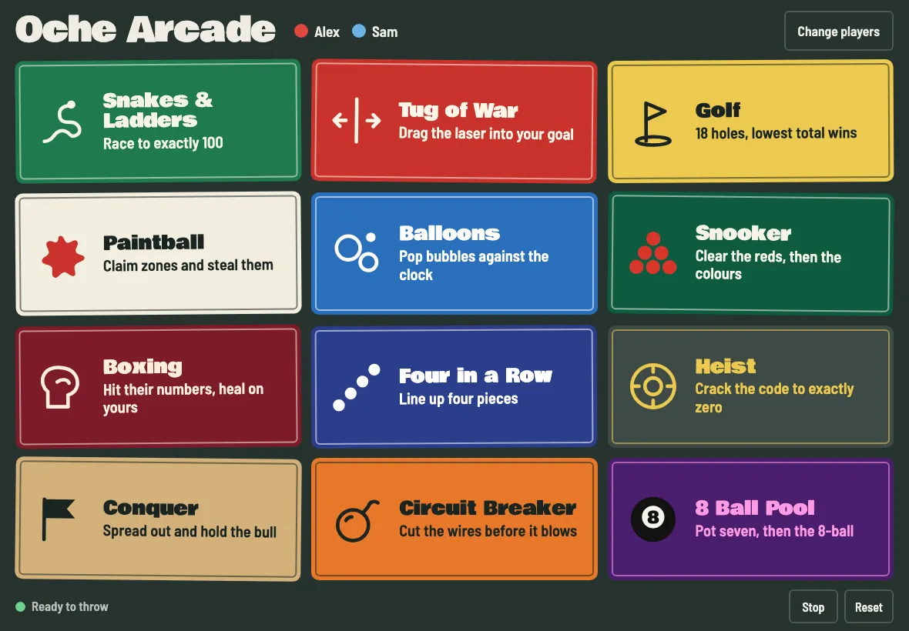

## Games

| | | |
|---|---|---|
| 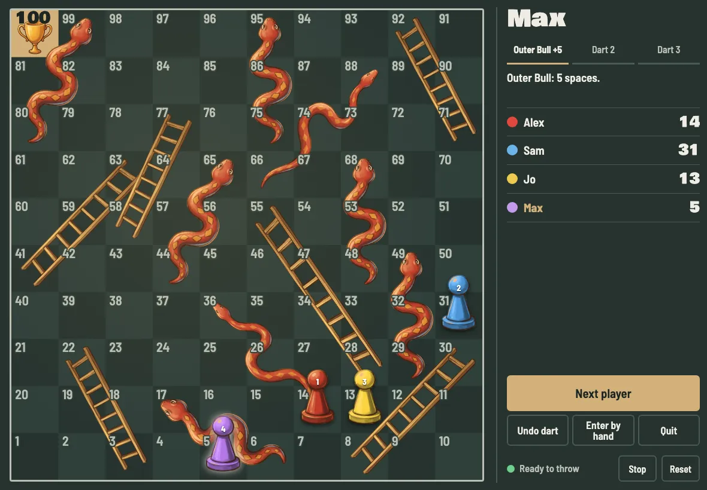<br>**Snakes & Ladders** | 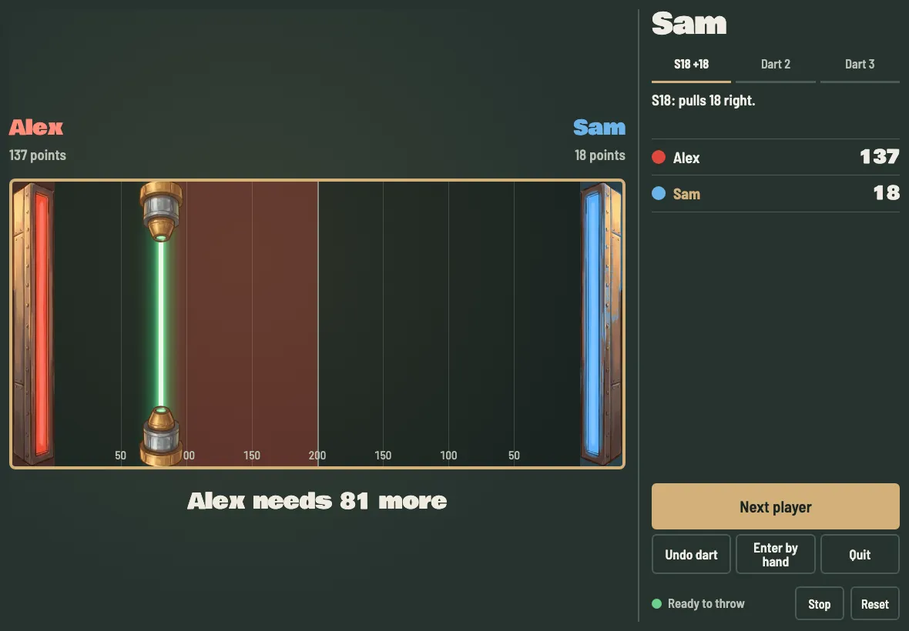<br>**Tug of War** | 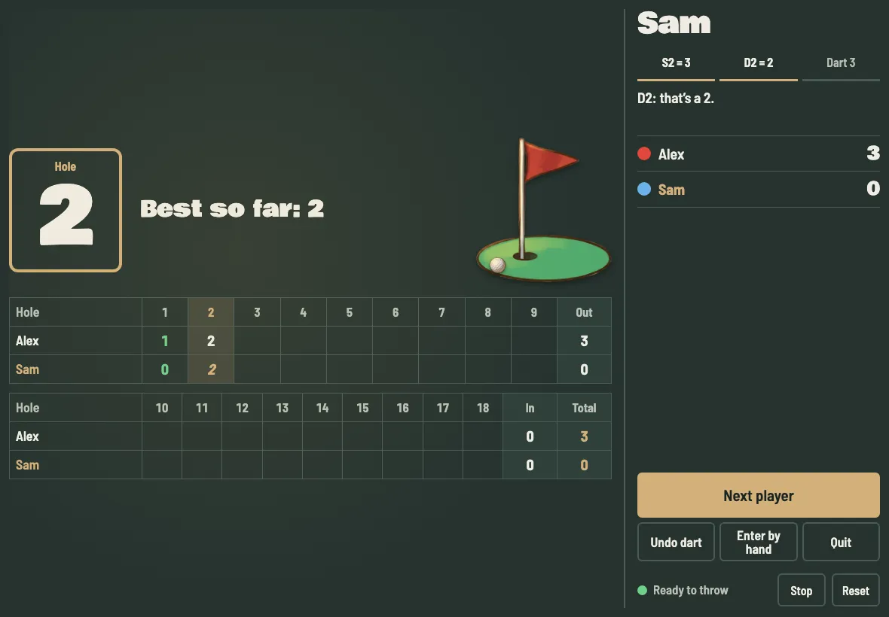<br>**Golf** |
| 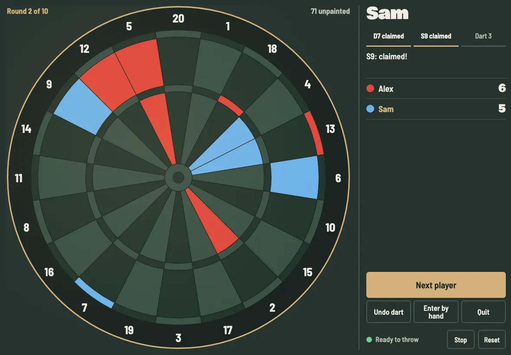<br>**Paintball** | 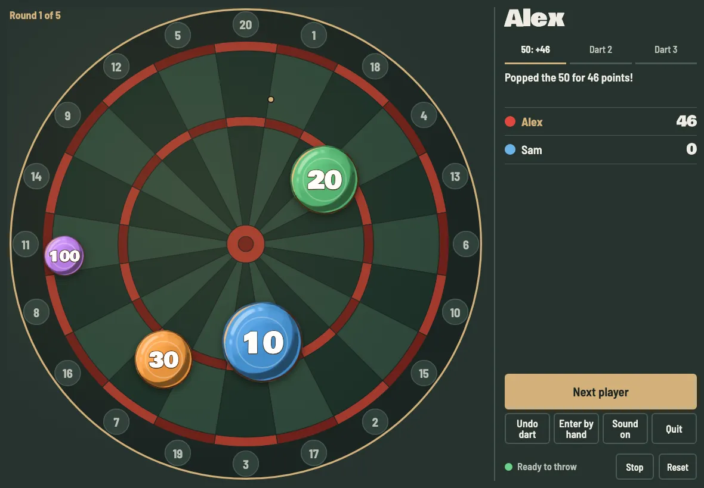<br>**Balloons** | 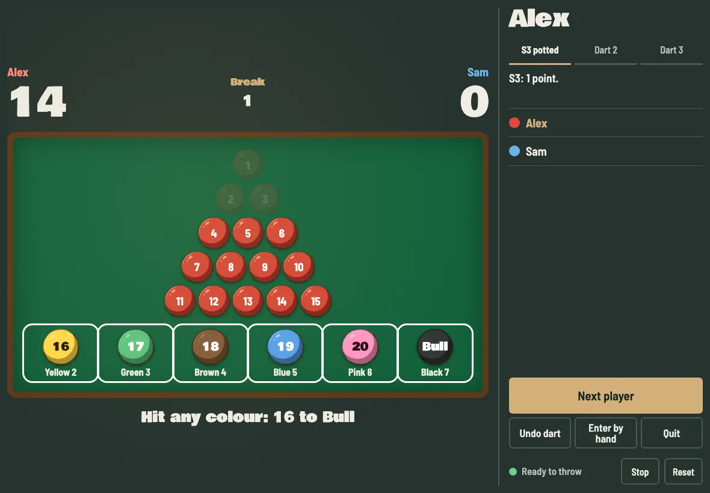<br>**Snooker** |
| 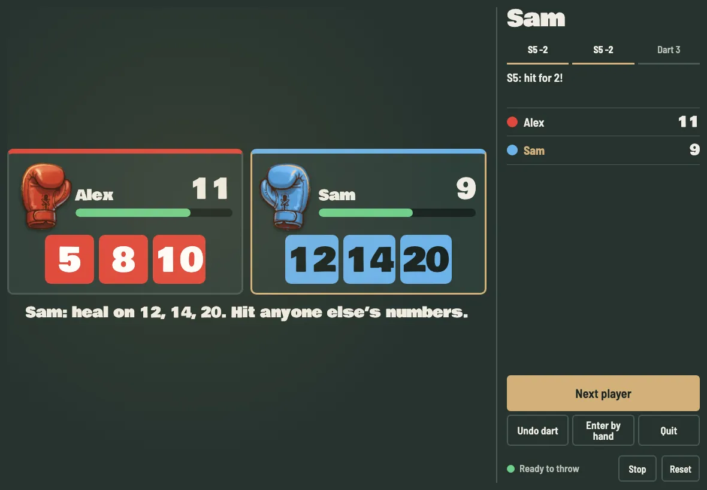<br>**Boxing** | 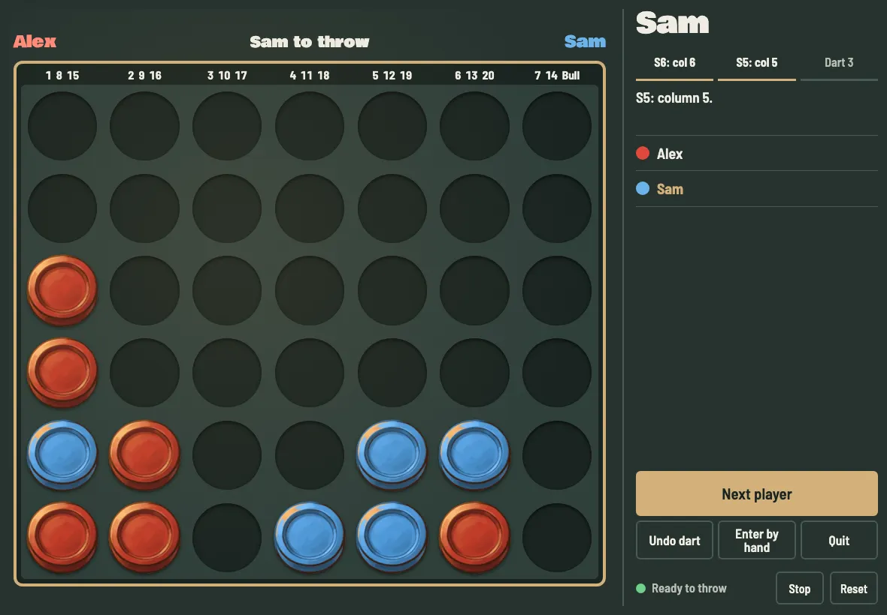<br>**Four in a Row** | 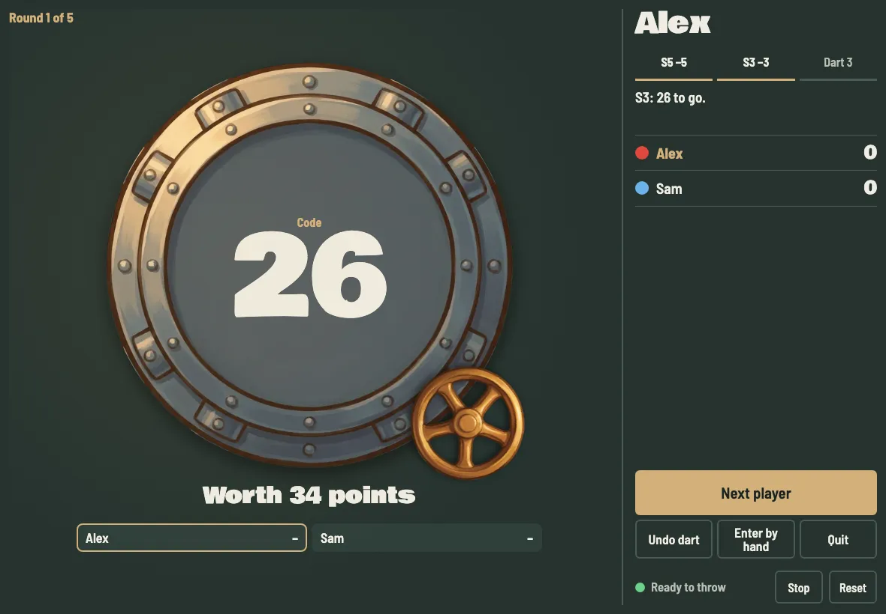<br>**Heist** |
| 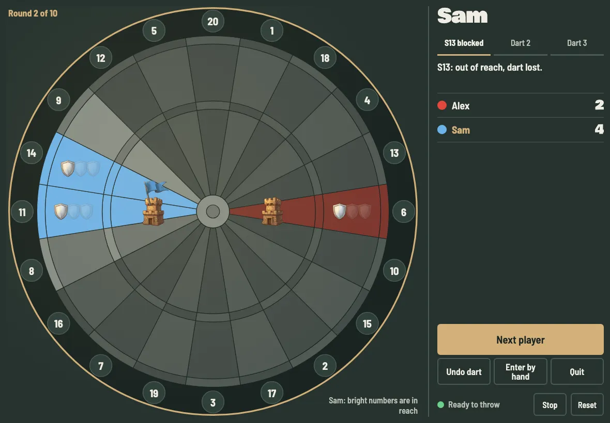<br>**Conquer** | 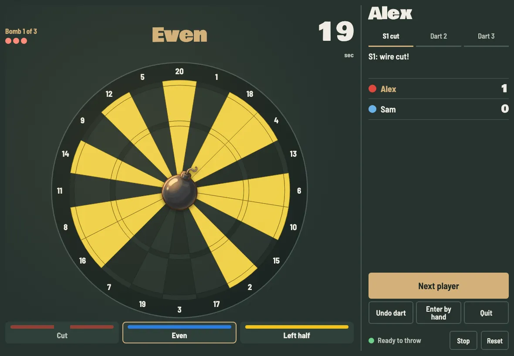<br>**Circuit Breaker** | 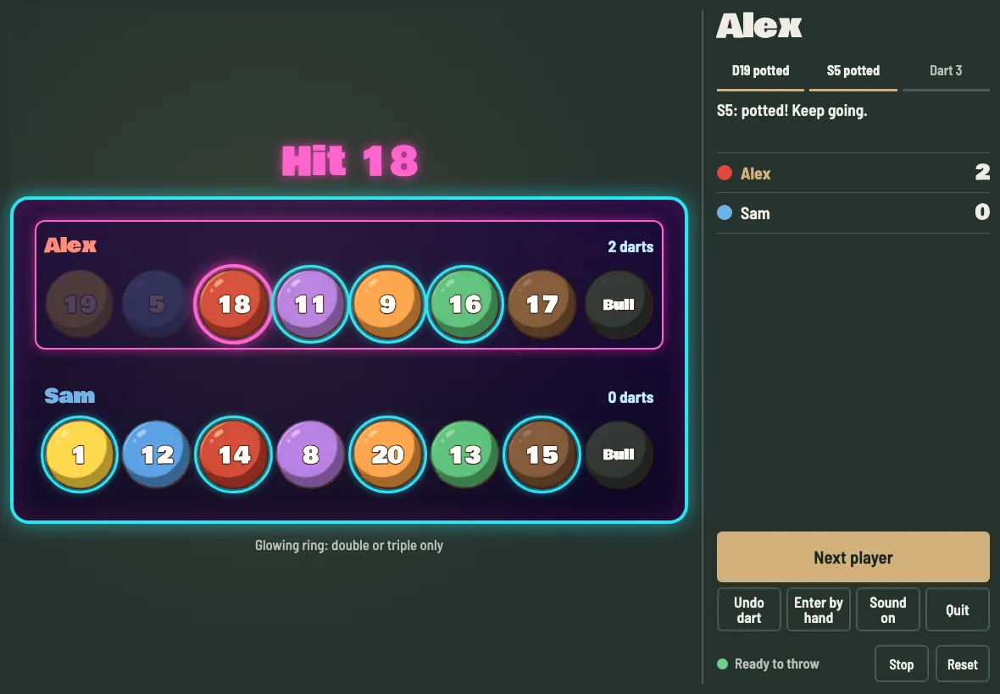<br>**8 Ball Pool** |

Each game has its own setup screen for its options and who throws first.

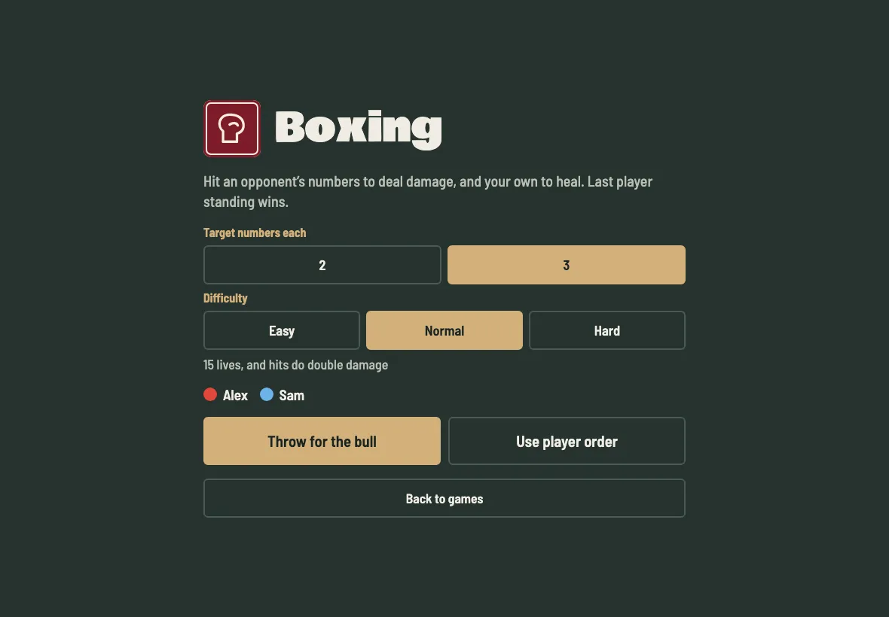

## Run

Get a copy of this folder onto the machine, then from inside it:

```bash
npm start
```

Then open `http://<machine-address>:8090` in a browser. On an iPad, use Share > Add to Home Screen to run it without Safari's toolbars.

| Setting | Default | Purpose |
|---|---|---|
| `PORT` | `8090` | Port the game is served on |
| `BOARD_URL` | `http://localhost:3180` | Board Manager address |
| `FEED_DELAY_MS` | `700` | Allowance for darts detected just after a timed turn ends |

## Develop without a board

```bash
npm run sim                                  # random darts on port 3181
BOARD_URL=http://localhost:3181 npm start
npm test
```

For manual control, run `node sim/board.js`, then call `/throw?bed=Triple&n=20`, `/throw?bed=InnerBull` or `/clear` on port 3181.

## Start automatically

Run the installer as your normal user from wherever you keep this folder. It detects the folder, your user and your Node, and asks for your password if it needs it.

```bash
deploy/install.sh
```

| Option | Purpose |
|---|---|
| `--port 8090` | Port the game is served on |
| `--board-url http://localhost:3180` | Board Manager address, if it's on another machine |
| `--dry-run` | Show the service definition without changing anything |
| `--uninstall` | Remove the service, leaving this folder alone |

| System | How it runs | Logs and restarts |
|---|---|---|
| Linux with systemd | Starts on boot | `journalctl -u oche-arcade -f`, `sudo systemctl restart oche-arcade` |
| macOS | Starts when you log in | `launchctl kickstart -k gui/$(id -u)/com.ochearcade.server` to restart |

On other systems, including Windows, start it with `npm start` using your system's own startup tools.

If you move this folder or change your Node version, run the installer again. Running it again replaces the service, so pass your options each time. To add another setting such as `FEED_DELAY_MS`, add it to the service definition afterwards.

## Fonts

Bowlby One and Barlow Semi Condensed are bundled in `public/fonts`, so the app works offline. Both use the SIL Open Font License, included alongside them.

## License

MIT, see [LICENSE](LICENSE). The bundled fonts keep their own license, as above.
